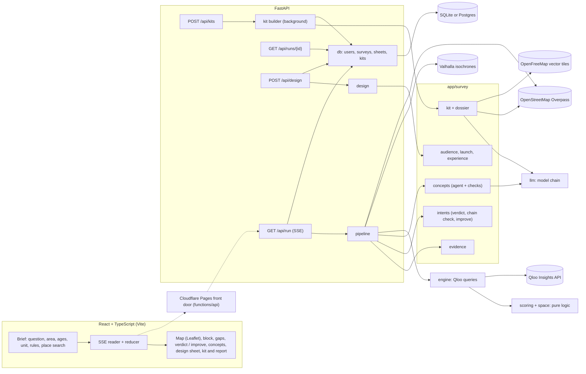

<picture>
  <source media="(prefers-color-scheme: dark)" srcset="docs/brand/banner-dark.svg">
  
</picture>

# Walk-in

**Taste-based void analysis for the owner. Drop a pin on an empty storefront: Walk-in reads Qloo's taste data for the area people can reach from that door, on foot or by car, ranks what the area is missing, designs the business to fill it and makes a free launch kit.**

| Judging criterion | Evidence |
|---|---|
| **Technological implementation** | • An agent loop: a tool-using model tests its hunches live against Qloo, then hard checks hold each concept to the owner's rules and the evidence, and repair or drop what fails ([app/survey/concepts.py](app/survey/concepts.py)).<br>• Qloo calls: `/v2/insights` on places, place tags, brands, artists, films, TV shows, podcasts, audiences and heatmaps, with location, age and interest signals and the brand filter; `/v2/tags`; `/search`; `/entities` ([every call](#why-qloo-is-essential), [app/engine.py](app/engine.py)).<br>• The walk or drive area is traced over real streets by Valhalla, with OpenStreetMap as a cross-check on what the area already has ([app/catchment.py](app/catchment.py), [app/osm.py](app/osm.py)).<br>• 961 tests, run on every push: 636 on the server (20 of them for the MCP tool) and 325 in the front end ([tests](tests), [frontend/src](frontend/src), [CI](.github/workflows/ci.yml)). |
| **Design** | • From one storefront to a ranked answer to a launch kit: a pin, a live log, gaps ranked with their reasons, a design sheet, then the kit ([What it does](#what-it-does)).<br>• Real street maps from OpenStreetMap on the window poster and the report's cover; the cover numbers the competitors and letters the places people here travel to, as the survey map does ([app/basemap.py](app/basemap.py), [SiteMap.tsx](frontend/src/components/kit/SiteMap.tsx)).<br>• Keyboard and screen readers: map pins take focus and carry labels, Enter opens a place's card and Escape gives focus back; arrow keys pan the map and Enter places a site; progress is announced; reduced motion is respected ([pinLayer.ts](frontend/src/map/pinLayer.ts), [SurveyMap.tsx](frontend/src/map/SurveyMap.tsx), [LiveStatus.tsx](frontend/src/components/LiveStatus.tsx)). |
| **Potential impact** | • Made for vacant storefronts, about 11% of all storefronts in New York City ([NYC Comptroller, June 2026](https://comptroller.nyc.gov/reports/whos-minding-the-storefronts)), and the owners who can't afford the site-selection reports sold to landlords and brokers ([Why it exists](#why-it-exists)).<br>• The launch kit is free: checked ad copy, a window poster, tracked links and a report of up to 12 sections for a landlord or a lender ([app/survey/kit.py](app/survey/kit.py), [app/survey/dossier.py](app/survey/dossier.py)).<br>• Business model: always free for owners; brokers and landlords pay a monthly subscription per broker to survey their vacant listings and hand prospective tenants the kit. It is the plan: nothing is charged today ([Business model](#business-model)). |
| **Quality of the idea** | • Void analysis, the method commercial real estate uses to find what an area lacks, run on taste and made for the owner ([Why it exists](#why-it-exists), Qloo's [Clarion Partners story](https://www.qloo.com/resources/client-stories/clarion-magnificent-mile)).<br>• Measured head-to-head against a plain chatbot: across 15 storefronts in 15 cities on 6 continents, a plain chatbot's top pick was a coffee shop, café or bakery at 10 of them (coffee shop 5, bakery 3, café 2); Walk-in's 15 top picks were 14 different kinds of place, each a place type people around that storefront rank highly. Both sides' picks faced the same median of 8 competitors, and Walk-in's come from the data the comparison reads ([the comparison](#against-a-plain-chatbot), [method and results](eval/head-to-head/)). |

Built for the [Qloo Agentic Hackathon](https://qloo.devpost.com/), which judges these four criteria equally. Taste data by [Qloo](https://www.qloo.com).

## Try it

- **Live:** https://walkin-app.pages.dev. Running a survey needs no sign-up.
- **See a finished example.** The first screen lists finished example surveys, and [walkin-app.pages.dev/examples](https://walkin-app.pages.dev/examples) has them all, each with its launch kit and report. They are there for every visitor, not only for judges. Opening one costs nothing and needs no sign-in: it replays a saved survey, so no Qloo or AI quota is spent.
- **From your AI assistant:** see [below](#use-walk-in-from-your-ai-assistant).

## Why it exists

Void analysis is how commercial real estate finds the businesses an area is missing: reports sold to landlords and brokers, built on which chains are already present or on foot traffic counted from phones. Walk-in does that job from taste, for the person opening the business:

- **Demand from taste.** Qloo measures what the people in this exact area love, and where they travel to get it, independents included.
- **An owner as the user.** It answers the person opening or running the business, not a broker.
- **A real walk or drive.** The area follows the streets, not a ring drawn around a pin.
- **A concept, not a tenant list.** It designs the business and makes a free launch kit for it.

The need is real. Qloo's own [client story](https://www.qloo.com/resources/client-stories/clarion-magnificent-mile) tells how Clarion Partners, a real estate investor, used Qloo's audience insights "down to a city block" to win an athleisure brand as a tenant on Chicago's Magnificent Mile. Walk-in makes that self-serve. And it answers from measurements: asked "what should open here?" about 15 storefronts in 15 cities, a plain chatbot's top pick was a coffee shop, café or bakery at 10 of them ([below](#against-a-plain-chatbot)).

## Business model

Free for owners. Brokers and landlords pay a subscription to survey their vacant listings and hand prospective tenants the kit.

- **Price:** $49 per broker per month, unlimited storefronts; always free for owners.
- **Why it holds:** in New York City about 11% of storefronts are vacant, and in many neighborhoods 80–90% of the vacant ones had already been empty for at least nine months ([NYC Comptroller, June 2026](https://comptroller.nyc.gov/reports/whos-minding-the-storefronts)). Landlords lose rent every empty month.
- **Today:** nothing is charged in the app. This is the plan.

## What it does

Pick one of three questions and drop a pin, or search an address. A dropped pin shows its street address, from OpenStreetMap's Nominatim, and the site's name links to Google Maps. Then choose the area and, if you like, who you want to serve:

- **The area:** a walk or a drive of 5 to 60 minutes, or a road distance of 1 to 100 km. A short walk suits a city block. Big areas suit towns, suburbs and destination businesses; in a dense city a big area holds almost everything, so few gaps show.
- **Who you want to serve:** everyone, under 25, 25–34, 35–54 or 55+. An age focus leans every Qloo ranking toward that age group, so it changes what is ranked as missing and whose favorites count. In Williamsburg, an Under 25 focus surfaces Cheesesteak, Jeans shop and T-shirt store as gaps; 55+ surfaces Mexican, Sandwich shop and Diner.

You can also describe the unit (size, kitchen, outdoor space), narrow the business type (food and drink, retail, or leisure and wellness) and write your rules in plain words ("no alcohol, halal, family friendly, mid-range prices").

The three questions:

- **Find what's missing.** Walk-in ranks what the area lacks, then designs the three strongest businesses the unit can host, plus at most one wild card, marked as untested.
- **Test my idea.** Type the business you want to open ("bakery", "sports bar"). Walk-in finds its Qloo category, measures it like the rest of the table when it must, ranks it among the site's gaps and gives a verdict: strong, possible, weak, thin data, or doesn't fit (the unit or your rules). The main reason comes with it ("people here rank it only #25 among place types"). Name a chain, and Qloo's brand graph counts its stores in the area while the verdict judges the category its stores are filed under: "50+ Starbucks locations are already inside the 15-minute drive." Your idea is designed first, next to the two strongest alternatives.
- **Improve my place.** Find your place on Qloo. Walk-in compares it with the places people here love in its category, like with like, and lists changes, each with its evidence: what reviews flag, what most of those places are known for and yours is not, opening hours, the rating gap, the trips people here make for your kind of place, and what to play.

Each survey shows its work as it runs. A live log follows every step and the agent's reasoning. The map shows the area, every place inside it and Qloo's taste heatmap for the category you open. A category's competitors are numbered 1, 2, 3 to match its lists, the places only OpenStreetMap shows come next, and the places people here love are lettered A, B, C, with arcs to those outside the area; a legend explains them. Once the survey runs, the map docks beside the results (a strip on phones) and can grow to fill the screen.

Every survey is saved and can be shared by its link. Signing in with Google keeps your surveys and launch kits in My places.

## How it works

1. **The area.** Valhalla traces the area reachable on foot or by car in the chosen minutes, or within the chosen road distance, over OpenStreetMap's streets, so rivers, parks and highways cut it. On Zamalek, Cairo's Nile island, the 10-minute walk is 0.93 km², less than half of an 800 m circle. The same request returns a trip twice as long or as far (a 20-minute walk for a 10-minute walk), which supply is compared with, up to the free routing server's limits of 60 minutes and 100 km; an area already at the limit compares supply with a circle twice as wide. If routing fails, the area becomes a circle and the report says so.
2. **Qloo reads the area.**
   - The block: every place Qloo lists inside the area (up to 100), with ratings, hours and review keywords grouped into themes, so one complaint written five ways counts once ("long lines", "wait time" and "queues" are one theme: long waits and lines). The block's classics are the places with a Michelin Guide listing or 250+ TripAdvisor reviews.
   - Demand: the place types people inside the area engage with, ranked, and the same ranking for six same-size areas around (a few kilometers away for a walk, farther for a bigger area).
   - Taste: the brands, artists, films, TV shows and podcasts people within 1.5 km (or as far as a big area reaches) over-index on, against three same-size areas around.

   With an age focus, each of these rankings leans toward that age group, here and around alike. A comparison area where Qloo lists almost no place (open water, a rail yard) is moved nearer, farther or a little to the side, or left out.
3. **Gaps.** For the eight place types people here rank highest (within the business type chosen), Walk-in measures:
   - **demand:** the rank here against the median rank in the areas around;
   - **supply:** the places of the type inside the area against what the larger area holds, scaled to the area's size and to the site's median across types, so parks and water around do not bias every type. OpenStreetMap is read for the same area (up to 30 km²), and a place only it shows counts as supply too, so a kind of place missing from Qloo's list is never called missing;
   - **pull:** the places of the type people here love more than the rest of the city does, how many of them lie outside the area, and the median trip to those;
   - **fit:** when the owner describes the unit, whether it can host the type (a seafood restaurant needs a full kitchen with extraction) and how many guests it holds; and whether the owner's rules allow the type at all.

   Together they make a gap score out of 100. Types Qloo barely knows here are flagged as thin data, and types whose loved places are mostly hotels or malls as atypical; both are discounted.
4. **Concepts.** An agent reads the evidence, tests its own hunches live against Qloo and proposes three concepts, which the server then checks ([below](#the-agent-and-its-checks)). Without a model, or when every free model is busy, evidence rules design them.
5. **The design sheet.** Opening a concept builds its sheet from the evidence, with no model call. It keeps the concept's own name, one-liner and signature items, and adds:
   - the offer: what the places people here love are known for, those no place inside the area offers first, within the owner's rules. An item needs evidence: a lone word that one place's reviews mention once or twice, with no Qloo tag behind it ("medicine" at a café), is left out;
   - the hours those places typically keep;
   - capacity, when the owner gives the unit's size: a planning estimate from the building code's occupant load factors;
   - who you'd win: the age groups and gender the places people here love of that kind lean toward, from Qloo's audience data, and the ad setting that follows ("Ages 30–44, women"). When too few of those places have data of their own, the sheet shows that kind of place in general and says so; when Qloo has none at all (night clubs), the section is left out. When the places of that kind already inside the area clearly draw another age group or lean toward the other gender, a positioning tip names who the loved places draw and they don't; that is rare on real data, so most sheets go without it;
   - the experience plan: a soundtrack for every concept, films and shows for screen nights at bars and venues, and podcasts for talks at bars, venues, cafés and bookstores, all from what the area over-indexes on;
   - the launch plan;
   - how the concept meets each of the owner's rules.
6. **The launch plan.** Who to reach, where, when, and what an ad can truthfully say. Each claim carries the numbers that make it true today. "The only bakery within a 10-minute walk" appears only when Qloo lists no bakery inside the area and OpenStreetMap shows none either; if OpenStreetMap could not be read, the proof says to walk the block first. "Without crossing town" appears only when most of the places people here love of that kind are outside the area. The plan gives settings to paste: Spotify (fans of named artists and podcasts), Nextdoor (the area's neighborhoods), a Google Ads custom segment (the websites of the places people here travel to) and a local radius that covers the area. The Spotify and local ads also take the age range and gender when the lean is clear. No claim names a competitor, and the checks to make before an ad runs follow the plan's own claims.
7. **The launch kit (free).** Ad copy for each channel of the plan, within each platform's limits and checked line by line; a window poster; tracked links for each channel; and a report to take to a landlord or a lender, printable as a PDF. The poster and the report's cover draw a real street map of the area from OpenStreetMap: from its Overpass servers, or, when none answers within 40 seconds, from OpenFreeMap's vector tiles of the same data; a kit saved without one gets it the next time it is opened. The cover marks the competitors with the survey's numbers and the places people here travel to with its letters. No street or shore is made up: only when neither source answers do the maps draw the area and its places alone and say so. The QR code and the tracked links wait for a page of yours (a website, an Instagram or Facebook page, a Google Maps listing or a WhatsApp link), which they open, tagged per channel; the tags can only be counted on a website.

The report has up to 12 sections: the cover, the case, the alternatives, the competition, where customers go now, the offer, the room, the experience, the launch, the first 90 days, before you sign, and method and limits. A section the evidence cannot support is left out rather than padded. No number in it comes from a model: each is quoted from the survey or worked out from it, and every section says where it comes from.

## Why Qloo is essential

A map search lists what is there: names, ratings, reviews. It cannot say what the people around a door love compared with the next neighborhood, or where they go for it. A chatbot knows nothing about the block; with web search it finds pages, not measurements. Qloo's taste data gives Walk-in four things neither can:

1. **The taste of the people inside the area, against same-size areas around.** Qloo ranks place types, brands, artists, films, shows and podcasts for a location signal: here, the area's own outline. Set against same-size areas nearby rather than the whole city, the ranking shows what this area cares about more than its surroundings. Qloo's demographic signal does the same for one age group.
2. **The places they love more than the rest of the city does, and the trips they make to reach them.** Qloo ranks places, independents included, for the area and for the wider city. Once the city's shared favorites are set aside, what remains is this neighborhood's own. Where those places lie outside the area, people here make a trip that a business on the block could save them.
3. **Who those places draw.** Qloo's audience data on the loved places gives the age groups and gender they lean toward, and with them the ad settings an owner can use.
4. **Cross-domain audiences for ads.** What people here over-index on in music, podcasts, TV, films and brands becomes targeting an ad platform accepts: Spotify takes fans of named artists and podcasts, and Google's custom segments take websites.

Qloo's brand graph adds the chain check: how many of a chain's stores already stand in the area.

| Question | Qloo call |
|---|---|
| What is inside the area? | `/v2/insights` with `filter.type=urn:entity:place`, `filter.location=<area polygon>`, `filter.location.radius=0` |
| What do people here engage with? | `filter.type=urn:tag`, `filter.tag.types=urn:tag:genre:place`, `signal.location=<area polygon>` |
| ...compared with same-size areas around | the same, with `signal.location=<point>` and `signal.location.radius=<area radius>` at six reference points |
| ...for one age group | the same calls with `signal.demographics.age` (`24_and_younger`; `25_to_29,30_to_34`; `35_to_44,45_to_54`; `55_and_older`) |
| Is a reference area a neighborhood? | `urn:entity:place` around the point: fewer than three places means open water, a rail yard or an airfield, so it moves or is left out |
| How many places of a type are inside the area, and in the larger area? | `urn:entity:place` with `filter.tags=<genre>` and each area's polygon, page by page |
| Which places do people here love more than the city does? | `urn:entity:place` with `filter.tags=<genre>`, ranked by `signal.location=<area polygon>` and by `signal.location=<point>` with a 20 km radius (wider for a big area) |
| Which places are the block's classics? | place records' Michelin and TripAdvisor references, review keywords and `primary_genre` |
| What does the area over-index on? | `urn:entity:brand`, `artist`, `movie`, `tv_show` and `podcast` with `signal.location` (1.5 km, or the area's own size), against three same-size areas around |
| Who do the loved places draw? | `filter.type=urn:demographics` with `signal.interests.entities=<the loved places>`; for a kind of place in general, `signal.interests.tags=<genre>` |
| Where is a category's taste strongest? | `filter.type=urn:heatmap` with `signal.interests.tags=<genre>` |
| Does a hunch, or the owner's idea, hold up? | `/v2/tags` resolves free text to a place genre, then the supply and favorites calls above, scored on the table's scale |
| Is the idea a chain, and how many of its stores are here? | `/search` with `types=urn:entity:brand`, then `urn:entity:place` with `filter.references_brand=<brand>` inside the area and the area twice as far |
| Do a category's fans share the area's taste? | `urn:entity:brand` and `artist` with `signal.interests.tags=<genre>` and `signal.location=<site>` |
| Which place is the owner's? | `/search` with `filter.location=<lat,lon>` and `filter.radius` (miles), then `/entities`, then the full record through insights within 60 m |
| Is a place only OpenStreetMap shows really missing from Qloo? | `/search` for its name around where it stands |

Without Qloo there is no demand, no pull, no taste and no audience: the product cannot exist. Each survey shows how many Qloo queries it read and the date of the oldest answer.

## The agent and its checks

The agent is a tool-using model that works like an analyst, in two or three turns (six at most). It reads an evidence pack: the gap table, what reviews of the block mention, what the area over-indexes on, the unit, the owner's rules and request, and a wild-card candidate when the evidence has one. Its tools:

- `test_category` (three per survey): measures a category the table does not cover, live and on the table's scale. Its hunches come from the area's taste: sports teams among the brands people here favor suggest a sports bar.
- `fan_taste` (four per survey): what people who love a category also love, and whether it overlaps the area's signature taste. When Qloo ranks a category's fans like everyone nearby, the agent is told this is no evidence either way.
- `inspect_gap`: the competitors inside the area, what reviews know them for and complain about, and what the loved places offer.
- `submit_concepts`: three concepts on different businesses, each with a name, a one-liner and signature items, plus the wild card when there is a candidate.

The model only chooses, names and positions. The server writes every factual line (why here, who it is for, the competition, the risk) from the measurements, and checks the rest after the model answers:

- **The owner's notes are hard rules.** Walk-in reads plain instructions into rules: no alcohol, halal, vegetarian, family friendly, a price band in words (budget, mid-range or upscale), the unit's size, and its kitchen or extraction hood. The page lists what it understood. A category the rules forbid is never proposed. A signature item that breaks a rule (fries in a unit without a hood, pork for a halal owner) is taken out and replaced from the evidence; a name or one-liner that breaks one gives way to the evidence's own. A concept that still breaks a rule after this one repair is dropped. Notes under the concepts say what was repaired or dropped, and why, and each concept says how it meets each rule.
- **Lines that say nothing, or too much.** A one-liner that leans on filler (cozy, vibe, curated, welcoming…) or states a figure the evidence does not give (a seat count, a floor area, a year) is replaced by the evidence's own line. A competitor placed "next door" becomes "nearby".
- **Real places, original names.** A concept must be a category the survey measured, one per kind of business (not brunch and breakfast), and never too broad to open ("Personal care"). The places it cites must be ones people here love. A name that reuses an existing place's name, or is only a category and a neighborhood, is replaced.
- **Measurements outrank hunches.** A concept on a gap scoring under 30 is replaced by the strongest fitting gap while stronger ones exist, unless it is the owner's own idea. When nothing scores 30, the page says the concepts are options to test, not gaps waiting to be filled.
- **The wild card.** Two things people here demonstrably love, combined into one storefront that no place inside the area already is ("a bakery by day and a wine bar by night"). It keeps the same rules, is marked untested, and is never ranked.
- **Ad copy.** The kit's copy is written by the model and read line by line. A line is rejected when it states a number no claim gives, a price, a discount or a free offer; names another business, or an artist, show, podcast or brand from the audience; says "only" beyond what its claim proves; reaches for a superlative (best, #1, famous) or leans on filler; carries a web address; or breaks the owner's rules or the platform's limits. Rejected lines go back to the model once, with the reasons. Whatever is still missing is written by rules from the claims, so a kit always works without a model.
- **No model, no dead end.** When no model is set up, or every free model is resting, evidence rules design the concepts and write the copy, and the page says so. Beside the concepts, the page also shows what a language model suggests for the same pin with no data, struck through.

## Use Walk-in from your AI assistant

[`mcp_server/walkin_mcp.py`](mcp_server/walkin_mcp.py) is an MCP server. It speaks MCP over stdio, so any MCP client that launches stdio servers can use it, and it calls only Walk-in's public API, so it needs no keys. It was tested with the MCP SDK's client in the tests ([tests/test_mcp_server.py](tests/test_mcp_server.py)). It covers two of the three questions, what's missing and testing an idea. Its tools:

- `survey_storefront` surveys a storefront. It takes a `place` (an address or a neighborhood) or `lat` and `lon`; `travel` (`walk`, `drive` or `distance`) with `minutes` (5–60) or `km` (1–100); `ages` (`all`, `under_25`, `25_34`, `35_54` or `55_plus`); and, to test an idea, an optional `business`. It returns the area, the age focus, the top 5 gaps with their reading and evidence, the concepts, the verdict and chain line for a business tested, and the survey's link, where the design sheets and the free launch kit are. A survey takes 1 to 3 minutes and spends Qloo and AI quota; each step is sent as a progress notification.
- `list_examples` takes nothing and returns the finished example surveys: each site and area, what is most missing, the concepts, and links to the survey, its launch kit and its report. It is free.
- `get_survey` takes a run id or a survey's `/s/` link and returns that survey, summarized like `survey_storefront`; for a survey still running, what it has found so far. It is free.

Setup and limits are in [mcp_server/README.md](mcp_server/README.md).

## Against a plain chatbot

We asked a plain chatbot, with no map and no data, "What kind of business should open there?" about 15 storefront addresses chosen before any answer was seen. We compared its top pick with the top gap Walk-in's table ranks for the 10-minute walk around each address. The chatbot was Gemini on the app's own settings; Walk-in's side used no model.

Across 15 storefronts in 15 cities on 6 continents, a plain chatbot's top pick was a coffee shop, café or bakery at 10 of them (coffee shop 5, bakery 3, café 2); Walk-in's 15 top picks were 14 different kinds of place, each a place type people around that storefront rank highly.

What it does not show: by Qloo's count both sides' picks faced the same median of 8 competitors, so we don't claim the chatbot picks crowded categories; and Walk-in's picks come from the same Qloo data the comparison reads. Fifteen sites is small, with one chatbot answer each.

The method, every site's picks, the script and the caveats: [eval/head-to-head](eval/head-to-head/).

## What we measured, and changed because of it

We evaluated the pipeline on five sites (Upper East Side, Williamsburg, Lower East Side, East Austin, Zamalek). Each finding below changed the method; where the data could not support a feature, the feature was removed.

- **Comparing a neighborhood with the whole city is biased by scale.** At walk scale "New American" ranks #2 in both the Upper East Side and Williamsburg, but #17 across New York. Against same-size areas around each site it ranks #3–#4: no real lift. Walk-in compares against six same-size areas; real lifts survive (Upper East Side fine dining #7 here vs #15.5 around; East Austin breweries #2 vs #5.5).
- **A neighborhood's favorite places are mostly the city's famous places.** A neighborhood's top-10 favorites overlap the city's top-10 by 6–10 of 10, so "most favorites are outside the walk" was true everywhere. Travel is measured on the places people here love *more than the city does*, and only claimed with at least four of them.
- **"Fans of a category" are mostly that category's audience at large, and some categories are ignored.** For live music venues, breweries and coffee shops, Qloo returns the area's general ranking whatever the category; for seafood, the fans' artists are nearly the same in Brooklyn, Austin and Cairo. So the experience plan comes from the neighborhood's own signature taste (location against location), and fan taste only orders audiences where it is specific.
- **Water.** The walk always followed the streets, but supply was first compared with a circle, which crossed the East River from Williamsburg into Manhattan and covered the Nile around Zamalek. Supply is now compared with the area a trip twice as long reaches over the streets, so rivers and the sea count only where a bridge crosses them, and a comparison area that falls in open water is moved ashore or left out.
- **Age groups that rank alike are merged.** With the hackathon key, Qloo's rankings for 25–29 and 30–34 came back alike, as did those for 35–44 and 45–54. So the age focus offers the groups that rank differently: everyone, under 25, 25–34, 35–54 and 55+.
- **Demographics are leans, read over several places.** One place's age and gender skew is noisy: an early version read Williamsburg as "35–44 and under 25" from block to block. So "who you'd win" takes the median lean over the places people here love of the concept's kind, names an age group or a gender only when the lean is clear, and says there is no need to narrow an ad when nothing leans.
- **What came out the same everywhere, or was invented, was removed.** On real surveys the AI renders, the mood board, the interior description, the design-DNA blocks ("casual, lively, urban" almost everywhere) and the partner suggestions came out much the same from site to site or were invented. They told an owner nothing a search or a chatbot would not, so the design sheet now carries only what the evidence gives.
- **Rising and fading places were removed.** Qloo's audience growth takes a handful of fixed values and is mostly zero or negative.
- **Nothing is called newly opened.** Qloo has no opening dates. Established places are marked by evidence (Michelin, review volume); artists carry the year they started and films their release year.
- **Hours come from the places, not the model.** The design sheet's hours are the median opening hours of the places people here love of that type. About 7% of places are listed as closed every day, including busy chains and cinemas, so those count as unknown, not closed.
- **Search results are thin.** Qloo's `/entities` and `/search` records lack reviews, keywords and Michelin references; the owner's place is read again through insights within 60 m, which returns the full record.
- **Like with like.** An upscale, Michelin-listed Mexican restaurant was first told to open at 10 am and add vegan meals, because the Mexican places people here love are casual taquerias. A place is now compared with favorites like itself; when there are none, it gets its position, not borrowed advice. Building-bound amenities (drive-through, terraces) are never suggested.
- **A chain is judged as what it sells.** "Starbucks" is no category, and Qloo's brand search is fuzzy ("bakery" finds a chain with Bakery in its name). A chain counts only when the request carries its whole name, give or take words like "store" or "coffee", and the verdict judges the category Qloo files its stores under, next to how many of them the area already has.
- **Owner notes are rules, not hints.** Told "no alcohol licence", the agent still proposed a wine bar, and our test runs caught signature dishes that need a fryer or a pizza oven in a unit without a hood. Notes are now read into rules and checked after the model answers, as above.
- **The model writes no facts.** Free models misread numbers and invented seat counts ("a warm, 200-seat room") and neighbors ("the bar next door"). The model now only chooses, names and positions; every factual line is rebuilt from the evidence.
- **Repeated test runs, not one demo.** Twelve unseen sites (Chicago, London, Paris, Los Angeles, Plano, Cairo twice, Mexico City, Berlin, Asheville, Brooklyn, Austin) with owner notes and requests found global stars counted as local taste, retail requests answered with cafés, Paris counts capped at 50 and museums offered as cocktail bars' favorites; each is fixed.
- **Big drives stalled the server.** A 15-minute drive's outline has thousands of points, and every Qloo request simplified it again on the server's event loop, so the host's health check restarted the server mid-survey. The outline is now simplified once, on a worker thread, so drives up to 60 minutes no longer slow the server: East Austin's 15-minute drive went from 38 s, with a 15-second stall, to 3.8 s.

Other safeguards: negated review keywords ("not crowded") are not complaints, and review keywords that repeat a place's name or neighborhood do not count as what it is known for.

## What a result does not establish

- **Foot traffic, rents or sales.** Qloo measures taste and affinity. A gap is evidence for a decision, not a forecast; the report's first 90 days include counting passers-by at the door before signing.
- **A probability.** The gap score ranks categories within one site. Close scores are close calls.
- **Travel routes to favorites.** Trips to the places people here love are straight lines from the pin, given as medians, not routes.
- **That nothing has opened since.** "Only" and "new here" claims are true of the places Qloo lists, and OpenStreetMap shows, on the survey date. Qloo has no opening dates, and its answers are cached for up to a week (longer only when Qloo cannot be reached); the report dates its evidence.
- **Who lives there.** Walk-in reads Qloo's location signal as everyone active in the area, whether they live, work or visit there. So it says "people here", not "residents". An age focus leans the rankings toward an age group; it counts no one.
- **Head counts.** "Who you'd win" gives leans, not shares: "draws 35–44-year-olds most" means they over-index, not that most customers are 35–44. Qloo has no audience data for some kinds of place (night clubs, for one), and then the section is left out.
- **What a category's fans think locally.** Fan taste is the category's audience at large; it only orders audiences where it overlaps the area's own taste.
- **Complete coverage.** Qloo's data is thinner in less digitally active areas, and some categories are tagged broadly (Qloo's "Seafood" includes sushi and poke). Kinds of place that no OpenStreetMap tag pins down ("New American") are not cross-checked, and areas larger than 30 km² skip the OpenStreetMap check entirely, which the survey says.
- **The lease.** Capacity is a planning estimate from the International Building Code's occupant load factors, after kitchen, storage and circulation; the local code and the unit's certificate of occupancy decide. Walk-in cannot see the lease, the zoning or the licensing; the report lists the questions to ask.
- **The right to play.** Playing music or screening films and shows for guests needs public performance licenses.

## Architecture



- `app/engine.py` asks Qloo one question per function; `app/scoring.py` and `app/space.py` are pure functions over the answers (gap scores, classics, hours, capacity), unit-tested without a network. `app/demographics.py` holds the age groups and Qloo's names for them.
- `app/catchment.py` traces the area (a walk, a drive or a road distance) and the larger area; `app/osm.py` reads the places OpenStreetMap shows inside the area, once per survey, for the cross-check; `app/basemap.py` reads the streets and water around it, once per kit, for the report's and the poster's maps (from Overpass, else from OpenFreeMap's vector tiles through `app/vectortiles.py`, a small pure-Python vector-tile reader).
- `app/geocode.py` finds an address (`GET /api/geocode`) and names a dropped pin's street address (`GET /api/reverse`), both through OpenStreetMap's Nominatim.
- `app/survey/` is the application layer. `pipeline` streams a run; `evidence` is what the agent sees and what each gap says in words; `concepts` is the agent and its checks; `constraints` reads the owner's notes into rules; `intents` judges a requested business (with the chain check) or compares an existing place; `design`, `audience`, `experience` and `launch` build the design sheet; `kit` and `dossier` write the launch kit and its report, which `app/kits.py` builds in the background.
- `app/llm.py` chains free models across providers (Gemini, then Groq); `app/answers.py` replays an answer while the evidence and the prompt are unchanged.
- `app/db/` keeps users, sessions, surveys, design sheets and launch kits in SQLite or Postgres through SQLAlchemy; `migrations/` is the Alembic schema, applied on startup. `app/survey/snapshot.py` turns a finished run into compressed JSON and back.
- `app/auth.py` and `app/routes/account.py` handle Google sign-in, sessions, My places and account deletion; `app/routes/kits.py` serves the launch kits; `app/routes/examples.py` lists the finished example surveys (`GET /api/examples`); `app/ratelimit.py` limits what one visitor can ask.
- `app/schemas.py` types the JSON API (interactive docs at `/docs` on the API server, local or the Render instance). `GET /api/run` takes the site, the question and the area (`travel=walk|drive|distance` with `minutes` 5–60 or `km` 1–100) and the age focus (`ages`), and streams these events: `run`, `status`, `place`, `catchment`, `block`, `demand`, `taste`, `gaps`, `agent`, `replay`, `finding`, `explored`, `verdict`, `improve`, `concepts`, `baseline`, `notice`, `error`, `done`. The server writes the area's labels ("10-minute walk", "30-minute drive", "25 km drive") for the screens to show.
- `frontend/` is the React app, which FastAPI serves once built; `frontend/functions/` is the Cloudflare Pages front door.
- `mcp_server/` is the MCP server ([above](#use-walk-in-from-your-ai-assistant)); `eval/head-to-head/` is the comparison with a plain chatbot.

## Running on free AI tiers

Free Gemini keys allow about five requests a minute and a few dozen a day per model, and popular models are often overloaded. Groq's free tier allows 1,000 requests a day but only 8,000 tokens a minute per model, about two agent turns. Walk-in is built for that:

- **A chain of models across providers.** Every call walks `LLM_FALLBACK_MODELS`, then Groq's `GROQ_MODELS`. A rate-limited model rests for the provider's own retry delay, one out of daily quota for an hour (or until Groq says it is back), an overloaded one for two minutes and a hanging one for five; the next model answers meanwhile.
- **A short wait instead of giving up.** When every model is resting and one comes back within `LLM_MAX_WAIT` seconds (default 40), the agent waits for it, and the live log says "Free AI quota refills in N s".
- **Conversations survive a change of model.** If the model running the agent fails between tool turns, the next model continues the same conversation. Each model gets its own turns back exactly as it wrote them; turns from other models are cut down to the standard fields, with Google's documented `skip_thought_signature_validator` value where Gemini needs a thought signature.
- **Requests fit the token limit.** For a provider with a per-minute token limit, the oldest tool results are shortened until the request fits, instead of failing with HTTP 413.
- **Few calls.** The agent batches its tool calls, which run in parallel, so a survey takes two or three model turns. The design sheet and the report make none.
- **No repeated spending.** While a site's evidence and the prompts are unchanged, the agent's investigation is replayed (the log says so), and so are the kit's ad copy and the no-data baseline.
- **Never a dead end.** When every model is resting, the evidence rules design the concepts and write the copy, and the page says why.

## Setup

Requires Python 3.12, Node 22 and a Qloo hackathon key. On Windows (PowerShell):

```powershell
python -m venv .venv
.venv\Scripts\Activate.ps1
pip install -r requirements-dev.txt
Copy-Item .env.example .env       # then add your keys
cd frontend; npm ci; npm run build; cd ..
uvicorn app.main:app --port 8770
```

On macOS or Linux:

```bash
python3 -m venv .venv
source .venv/bin/activate
pip install -r requirements-dev.txt
cp .env.example .env              # then add your keys
(cd frontend && npm ci && npm run build)
uvicorn app.main:app --port 8770
```

Open http://127.0.0.1:8770. Without the build, the server serves the API only. For frontend work, keep the API running and use `npm run dev` in `frontend/` (it proxies `/api` to port 8770).

### Configuration

`.env.example` lists every setting with a comment. Only the Qloo key is required.

| Variable | Needed | Notes |
|---|---|---|
| `QLOO_API_KEY` | yes | The hackathon key, which works only with `QLOO_BASE_URL=https://hackathon.api.qloo.com` (the default) |
| `LLM_API_KEY`, `LLM_BASE_URL`, `LLM_MODEL` | no | Any OpenAI-compatible endpoint. Recommended free option: Gemini (`gemini-3.6-flash` via `https://generativelanguage.googleapis.com/v1beta/openai/`). Without a model, concepts and ad copy come from the evidence rules |
| `LLM_FALLBACK_MODELS` | no | Comma-separated models tried in order when the main one is rate limited, out of daily quota, overloaded or hanging. Free tiers are per model, so a chain multiplies capacity |
| `LLM_REASONING_EFFORT`, `LLM_TIMEOUT`, `LLM_TEMPERATURE` | no | Passed through when set. The timeout (default 45 s; the agent's first turn always gets 25 s) marks a model as hanging. Leave the temperature unset for Gemini 3 models |
| `GROQ_API_KEY`, `GROQ_MODELS` | no | A second free provider ([console.groq.com/keys](https://console.groq.com/keys), no card) whose models follow the chain above; it also works alone. Default models: `openai/gpt-oss-120b,qwen/qwen3.8-27b,openai/gpt-oss-20b`. `GROQ_REASONING_EFFORT` (default `low`) and `GROQ_TOKEN_LIMIT` (default 8000, the free tier's tokens a minute) are optional |
| `LLM_MAX_WAIT` | no | Seconds the agent may wait for a resting model before the evidence rules take over (default 40; `0` never waits) |
| `AGENT_CACHE` | no | `1` (default) replays the agent's answers, the kit's copy and the no-data baseline while a site's evidence and the prompts are unchanged; `0` always asks the model |
| `KIT_DAILY_LIMIT` | no | Most launch kits the server builds per day, UTC (default 60); each visitor may start 12 an hour |
| `DATABASE_URL` | no | Where users, surveys, design sheets and launch kits are kept. Empty: a SQLite file, `.data/walkin.db`. On a host whose disk does not survive a restart, use Postgres; Neon's direct and pooled connection strings both work as copied |
| `SURVEY_RETENTION_DAYS` | no | Surveys are deleted after this many days (default 60), with their kits, unless a signed-in user keeps them in My places |
| `EXAMPLES` | no | The finished surveys anyone can open before running their own: comma-separated survey ids (the id in `/s/{id}`). They are listed on the first screen and at `/examples` with their launch kit and report, and are never deleted |
| `PUBLIC_URL` | no | The app's public address. When it is https, cookies are Secure and the development login is off |
| `GOOGLE_CLIENT_ID` | no | Sign in with Google: a web client from the Google Auth Platform, with the site's address (and `http://localhost:5173` for development) in its Authorized JavaScript origins. Without it nobody can sign in, so nothing is kept in My places |
| `SESSION_DAYS` | no | Days a sign-in lasts (default 30); using the app renews it, at most once a day |
| `AUTH_DEV_LOGIN` | no | Development only: `POST /api/auth/dev` signs in with any email. Ignored when `PUBLIC_URL` is https |
| `ALLOWED_ORIGINS` | no | Other origins whose pages may POST to the API, besides `PUBLIC_URL`'s and the server's own. In development the Vite server's origins are always allowed |
| `PROXY_SECRET` | no | Behind the Cloudflare Pages front door: a long random secret set on both sides (see [Deploy](#deploy)). Empty means no front door |

## Deploy

The live app has three free parts: the API on Render, the database on Neon, and the web app on Cloudflare Pages in front of both.

- **Render.** The `Dockerfile` builds the React app with Node, then serves it and the API from a slim Python image. `render.yaml` is a blueprint for Render's free Docker web service, in Ohio next to the Neon database, with `/api/health` as its health check: create a Blueprint from the repository and fill in the secrets it lists (`QLOO_API_KEY`, `DATABASE_URL`, `PUBLIC_URL`, `GOOGLE_CLIENT_ID`, `PROXY_SECRET`, `LLM_API_KEY`, `GROQ_API_KEY`) and `EXAMPLES`, the ids of the example surveys. The container trusts Render's proxy headers, so the app sees HTTPS.
- **Neon.** Render's free disk does not survive a restart, so surveys live in Neon's free Postgres: set `DATABASE_URL` to its connection string as copied. The app applies its Alembic migrations on startup; `alembic upgrade head` does the same from the command line.
- **Cloudflare Pages.** Render's free instance sleeps after 15 idle minutes and takes about a minute to wake. The web app is served from Cloudflare Pages, which never sleeps, and `frontend/functions/api/[[path]].ts` hands every `/api` request to Render, so the app, its sign-in cookie and the survey stream share one origin. While Render wakes, the front door answers 503 `{"waking": true}` and the app shows its own note while it retries. The Pages project needs `BACKEND_ORIGIN` (the Render address) and `PROXY_SECRET`. `.github/workflows/pages.yml` deploys `frontend/` on every push to `main` that changes it, with the repository secrets `CLOUDFLARE_PAGES_TOKEN` and `CLOUDFLARE_ACCOUNT_ID`; `frontend/public/_headers` sets the security headers. Set `PUBLIC_URL` on Render to the Pages address, and add that address to the Google client's Authorized JavaScript origins.
- **`PROXY_SECRET`.** Behind the front door, every request reaches Render from Cloudflare. The front door drops any copies a visitor sends of its own headers, then sends the visitor's address in `X-Client-IP` together with the secret. The API uses that address for its rate limits only when the secret matches; otherwise it uses the address Render's proxy saw. Use a long random value, the same on Render and on Pages.
- **Keeping it awake.** The app visits `KEEP_AWAKE_URL` every 5 minutes, so the free instance never sleeps; `app/keepawake.py` does it. Set it on Render to the front door's health check (`https://<the Pages address>/api/health`): each visit then leaves Render and comes back in through Cloudflare like a visitor's, which is what Render counts. The health check reads no database, so Neon still scales to zero between surveys. One instance awake all month fits the workspace's 750 free hours; leave it empty for a second free service in the same workspace. As a backup, `.github/workflows/keep-awake.yml` pings the backend every 10 minutes through the end of judging, which also wakes it if Render ever lets it sleep.

Any Docker host works the same way: `docker build -t walk-in . && docker run -p 8000:8000 --env-file .env walk-in`.

## Data and state

- Surveys, design sheets and launch kits are kept in a database: a SQLite file by default (`.data/walkin.db`, ignored by git), or Postgres when `DATABASE_URL` is set.
- A survey keeps running when its page is closed or refreshed. Its events are kept as they were streamed, each with the seconds since the start, and `GET /api/runs/{id}` returns `{id, status, created_at, events}`: from memory while the survey runs, from the database once it has ended. `status` is `running`, `complete` or `failed`. A survey failed when it stopped on an error, which its events explain, or when a restart cut it off: one still marked running 15 minutes after it started is reported as failed. On shutdown, running surveys get 10 seconds to finish.
- A finished survey is saved with its state, and each design sheet once it is made, so after a restart a sheet opens without being built again and the other concepts can still be designed. The state is stored as zlib-compressed JSON, packed and unpacked off the event loop. Older saved surveys, made before drives and age focus existed, still open as walks for everyone.
- A concept's launch kit is made once and kept with its survey, street map included. `POST /api/kits` returns it, or creates it and builds it in the background, designing the concept first when needed. A kit a restart cut off is built again at the next start. Anyone with a kit's link (`/k/{token}`) can open it. A kit saved without its street map gets it when it is opened: `GET /api/kits/{token}` waits up to 10 seconds for it, then finishes in the background for the next open.
- On startup, surveys older than `SURVEY_RETENTION_DAYS` are deleted with their design sheets and kits, unless a signed-in user keeps them in My places or they are among the `EXAMPLES`.
- Qloo's answers are cached on the server (`.cache/`, ignored by git) and reused for a week; after that Qloo is asked again, and the older answer serves only when Qloo cannot answer. Areas are cached too, and OpenStreetMap answers for a week.

## Data and privacy

- No Qloo answer is stored in this repository. The head-to-head's `results.json` holds only numbers worked out from Qloo's answers and Qloo's place-type names. Taste data is aggregated and anonymized.
- A survey keeps what you entered (the pin, the area, the age focus, the business or your place, your notes and the unit) and its results, so its link opens it as it ended. Anyone with a survey's link can open it.
- Signing in with Google keeps your Google account id, email, name and picture link, only to show that you are signed in and to list your surveys. Deleting your account in My places deletes it, its sessions and the surveys saved to it, with their design sheets and kits.
- Qloo, the AI providers and the map services are asked by the server, never by your browser. The AI providers read your brief, notes included, but nothing personal is sent to any of them: not your name, your email or your account. Map tiles load from Esri in your browser. Walk-in shows no ads and runs no analytics. The privacy page (`/privacy`) has the details.
- Areas come from the public [Valhalla](https://valhalla.github.io/valhalla/) instance run by FOSSGIS on OpenStreetMap data, the cross-check and the kit's street maps from public [Overpass](https://wiki.openstreetmap.org/wiki/Overpass_API) instances (the street maps, when those do not answer, from [OpenFreeMap](https://openfreemap.org)'s vector tiles, © OpenMapTiles), and addresses, a dropped pin's included, from [Nominatim](https://nominatim.org/). Map tiles © Esri, © OpenStreetMap contributors. OpenStreetMap data is available under the Open Database License.

## Tests

- Backend: `ruff check app tests scripts` and `pytest`. The tests drive the real HTTP app and survey pipeline against a synthetic Qloo world, with fake models, areas, OpenStreetMap answers and geocoder (`tests/fakes.py`). Each test gets a SQLite file of its own, and a test that opens a Postgres connection fails, so the tests never touch `DATABASE_URL`, even when `.env` names a production database.
- Frontend, in `frontend/`: `npm run typecheck`, `npm run lint` and `npm test` (Vitest: the stream parser, survey state, the brief, routes, map pins, the kit and formatting).
- MCP server: `tests/test_mcp_server.py` runs its three tools through the MCP SDK's client, with Walk-in's API mocked.
- GitHub Actions runs all of these, the frontend build and the Docker build on every push.
- With live Qloo data: `python scripts/evaluate_sites.py [site_id ...] [--minutes 10] [--focus any]` runs the full survey of a walk around each preset site, OpenStreetMap cross-check included, and prints a report for review; `python scripts/validate_qloo.py` repeats the day-one checks of Qloo's coverage; `eval/head-to-head/run_h2h.py` reruns the comparison with a plain chatbot.

## License

[MIT](LICENSE)
