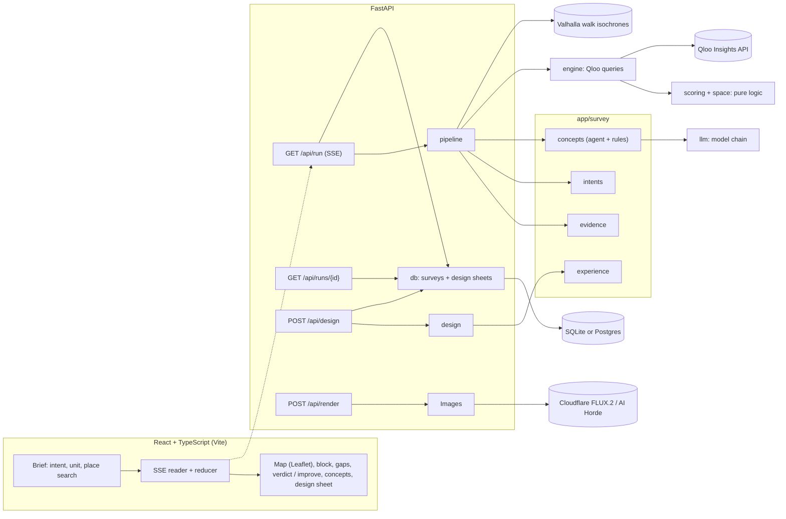

# Walk-in

**Drop a pin on an empty storefront. Walk-in reads what the people within a ten-minute walk love, finds what the block is missing, and designs the business they would walk in for. Or tell it what you want to open and it judges that, or point it at the place you run and it shows what to change.**

Built for the [Qloo Agentic Hackathon](https://qloo.devpost.com/). Taste data by [Qloo](https://www.qloo.com).

Landlords, brokers and founders decide what goes into a vacant unit by gut feel or by expensive foot-traffic reports. A plain language model answers "what should open here?" with the same café-or-wine-bar list for almost any address. Walk-in answers from evidence: who lives within walking distance, what they engage with more than the neighborhoods around them, how much of it the block already has, which places they love that are not on the block, and whether the unit can host it.

## What it does

1. **Traces the walk.** A real 5, 10 or 15-minute walking catchment over the street network (rivers, parks and highways cut it), not a circle. On Zamalek, Cairo's Nile island, the 10-minute walk is 0.93 km², less than half of an 800 m circle.
2. **Reads the block.** Every place Qloo knows inside the walk: categories, ratings, price levels, and what reviews say, grouped into themes so one complaint written five ways counts once ("long lines", "wait time" and "crowded" are one theme: waits and crowding). And the block's classics: places with a Michelin Guide listing or 250+ TripAdvisor reviews, with what each is known for.
3. **Ranks what is missing.** For each place type locals engage with:
   - **demand**: the local rank against six same-size areas a few kilometres away;
   - **supply**: places inside the walk against what a block this dense typically holds;
   - **pull**: places locals love *more than the city does*, and whether they sit inside or outside the walk;
   - **fit**: when the owner gives the unit's size, kitchen and outdoor space, whether the unit can host the category (a seafood restaurant needs a full kitchen with extraction) and how many guests it holds.
4. **Answers what the owner asked.**
   - *Find what fits*: an agent works like an analyst. It forms hunches the gap table does not cover (sports teams among the area's favorite brands suggest a sports bar), tests them live against Qloo on the table's scale, checks which categories' fans share the area's signature taste, and proposes three concepts that fit the unit.
   - *Open a specific business*: "bakery" or "sports bar" is resolved to a Qloo category, measured live if needed, ranked among the site's gaps and judged (strong, possible, weak, thin data, or does not fit the unit) with the main reason ("locals rank it only #25 among place types"). It is designed first, next to the two strongest alternatives.
   - *Improve my place*: the owner finds their place on Qloo. It is compared with the places locals love in its category at a similar price: what reviews flag, what most of those places are known for, opening hours, rating and the trips locals make elsewhere, each move with its evidence.
5. **Designs it.** Each concept opens into a design sheet: interior mood, materials, layout and seating sized to the unit, offer, opening hours taken from the places locals love of that type, partners, and an experience plan: a soundtrack, films and shows for screen nights (bars and venues) and podcasts for talks (bars, venues and cafés), from what people within 1.5 km over-index on. Two AI renders show the full interior at the unit's real size and the shopfront from the street with the concept's name on the sign.
6. **Plans the launch.** The sheet ends with who to reach and what an ad can truthfully say, as settings to paste rather than a picture. Each claim carries the numbers that make it true today ("the only $$$ bakery within a 10-minute walk": none of the bakeries inside the walk that list a price is $$$, and at least two the locals love are). Audiences come from what people nearby over-index on. Then come the times and reasons people visit the places locals love of that kind (Qloo's tags), and settings for Spotify (fans of named artists and podcasts), Nextdoor (neighborhoods), Google custom segments (the websites of the places locals now travel to) and a radius that covers the walk. No claim names a competitor, and the checks to make before an ad runs follow the plan's own claims.
7. **Shows the work.** A live survey log with the agent's reasoning, a map with the walk, every place, competitors, arcs to the places locals travel to, and Qloo's taste heatmap for the selected category.

Every claim is checked against the evidence: invented places, genres, artists and partners are dropped, concept names that reuse a real place's name are replaced, and numbers are quoted from the evidence.

## Why it needs Qloo

| Question | Qloo call |
|---|---|
| What is inside the walk? | `/v2/insights` `filter.type=urn:entity:place`, `filter.location=<walk polygon>`, `filter.location.radius=0` |
| What do locals engage with? | `filter.type=urn:tag`, `filter.tag.types=urn:tag:genre:place`, `signal.location=<walk polygon>` |
| ...compared with similar areas around | the same, with `signal.location=<point>` and `signal.location.radius=<walk radius>` at six reference points |
| How many of each type exist nearby? | `urn:entity:place` with `filter.tags=<genre>` inside the walk and in a wider circle |
| Which places do locals love more than the city does? | `urn:entity:place` ranked by `signal.location=<walk>` versus `signal.location=<20 km>` |
| Which places are the block's classics? | place records' Michelin and TripAdvisor references, review keywords and `primary_genre` |
| What does the neighborhood over-index on? | `urn:entity:brand`, `artist`, `movie`, `tv_show` and `podcast` with `signal.location`, against three same-size areas around |
| Where is the taste strongest? | `filter.type=urn:heatmap` with `signal.interests.tags=<genre>` |
| Does a hunch, or the owner's idea, hold up? | `/v2/tags` resolves free text to a place genre, then the supply and favorites calls above, scored on the table's scale |
| Do a category's fans share the area's taste? | `urn:entity:brand` and `artist` with `signal.interests.tags=<genre>` and `signal.location=<site>` |
| Which place is the owner's? | `/search` with `filter.location=<lat,lon>` and `filter.radius` (miles), then the full record through insights |
| What does a place look and feel like? | place tags (decor, ambience, setting, menu highlights, offerings, amenities) and review keywords of the locals' favorites |

Without Qloo there is no block, no demand, no pull, no classics and no design DNA: the product cannot exist.

## What we measured, and changed because of it

We evaluated the pipeline on five sites (Upper East Side, Williamsburg, Lower East Side, East Austin, Zamalek). Each finding below changed the method; where the data could not support a feature, the feature was removed.

- **Comparing a neighborhood with the whole city is biased by scale.** At walk scale "New American" ranks #2 in both the Upper East Side and Williamsburg, but #17 across New York. Against same-size areas around each site it ranks #3–#4: no real lift. Walk-in compares against six same-size areas; real lifts survive (Upper East Side fine dining #7 here vs #15.5 around; East Austin breweries #2 vs #5.5).
- **Locals' favorite places are mostly the city's famous places.** A neighborhood's top-10 favorites overlap the city's top-10 by 6–10 of 10, so "most favorites are outside the walk" was true everywhere. Travel is measured on the places locals love *more than the city does*, and only claimed with at least four of them.
- **"Fans of a category" are mostly that category's audience at large, and some categories are ignored.** For live music venues, breweries and coffee shops, Qloo returns the area's general ranking whatever the category; for seafood, the fans' artists are nearly the same in Brooklyn, Austin and Cairo (no Egyptian artists at all). So the experience plan comes from the neighborhood's own signature taste (location against location), fan taste is used only as evidence of fit where it is specific, and it is never called local.
- **Crowd demographics were removed.** Qloo's age and gender skews describe a place's visitors and contradicted each other between neighbouring blocks (Williamsburg read "35–44 and under 25"); categories came back as "45+, leaning female" alike. Concepts describe who they are for through evidence: what neighbours rank and where they go now.
- **Rising and fading places were removed.** Qloo's audience growth takes a handful of fixed values and is mostly zero or negative.
- **Nothing is called new.** Qloo has no opening dates. Established places are marked by evidence (Michelin, review volume); artists carry the year they started and films their release year.
- **Hours come from the places, not the model.** The design sheet's hours are the median opening hours of the places locals love of that type. About 7% of places are listed as closed every day, including busy chains and cinemas, so those count as unknown, not closed.
- **Search results are thin.** Qloo's `/entities` and `/search` records lack reviews, keywords and Michelin references; the owner's place is read again through insights within 60 m, which returns the full record.
- **Like with like.** A Michelin-listed $$$ Mexican restaurant was first told to open at 10 am and add vegan meals, because the Mexican places locals love are casual taquerias. Places are compared with favorites at a similar price; when none exist, the place gets its position, not borrowed advice. Building-bound amenities (drive-through, terraces) are never suggested.
- **Owner notes are rules, not hints.** Told "no alcohol licence", the agent still proposed a wine bar. Notes are now read once into rules (no alcohol, halal, vegetarian, family friendly, a price range, the unit's size and kitchen) and applied to every category, offer, price and verdict; a ruled-out category says why, and the page shows what it read.
- **Prices are levels, from the places.** Qloo has price levels ($ to $$$$) for about four in five places, but price ranges for under 2% (mostly hotels) and no cost descriptions, so Walk-in never turns a level into a dollar figure. A concept's price is the median level of the places locals love in its category, set against the places inside the walk, with that basis printed; the model may move it one level to position the concept, never more. Each level is made concrete with real places at that level, linked to their own menus or websites (Qloo has a website for most places), and a level that locals love but no place inside the walk charges is called out as open.
- **The model writes no facts.** Free models misread numbers and invented seat counts ("a warm, 200-seat room") and neighbours ("the bar next door"). The model now only chooses, names and positions; every factual line is rebuilt from the evidence, and a positioning line that states a capacity or floor area the unit does not have gives way to the evidence's own.
- **Repeated test runs, not one demo.** Twelve unseen sites (Chicago, London, Paris, Los Angeles, Plano, Cairo twice, Mexico City, Berlin, Asheville, Brooklyn, Austin) with owner notes and requests found global stars counted as local taste, retail requests answered with cafés, Paris counts capped at 50 and museums offered as cocktail bars' favorites; each is fixed.

Other safeguards: categories Qloo barely knows locally are flagged as thin data; categories whose favorites are mostly hotels or malls are flagged as atypical; partners are makers, shops and designers (plus teams for sports concepts), never nonprofits, media groups or corporations; negated review keywords ("not crowded") are not complaints; review keywords that repeat a place's name or neighborhood do not count as what it is known for.

## Architecture



- `app/engine.py` asks Qloo one question per function; `app/scoring.py` and `app/space.py` are pure functions over the answers (gap scores, classics, hours, capacity), unit-tested without a network.
- `app/survey/` is the application layer: `pipeline` streams a run, `evidence` is what the agent sees, `concepts` is the tool-using agent and its grounding, `intents` judges a requested business or compares an existing place, `design` and `experience` build the sheets.
- `app/llm.py` chains free models across providers (Gemini, then Groq) with rate-limit-aware rests; `app/answers.py` replays an investigation when the evidence is unchanged.
- `app/db/` keeps users, their sessions, surveys, design sheets and launch kits in SQLite or Postgres through SQLAlchemy; `migrations/` is the Alembic schema, applied on startup. `app/survey/snapshot.py` turns a finished run into JSON and back, stored zlib-compressed. `app/survey/kit.py` and `dossier.py` write a concept's launch kit, which `app/kits.py` builds in the background.
- `app/schemas.py` types the JSON API (interactive docs at `/docs`). `GET /api/run` streams these events: `run`, `status`, `place`, `catchment`, `block`, `demand`, `taste`, `gaps`, `agent`, `finding`, `explored`, `verdict`, `improve`, `concepts`, `baseline`, `notice`, `error`, `done`.
- `frontend/` is the React app; FastAPI serves its build. Tests: `pytest` drives the real HTTP app and pipeline against a synthetic Qloo world, mocked models and image services; Vitest covers the stream parser and state. GitHub Actions runs lint, type checks, both test suites and the Docker build.

## Running on free AI tiers

Free Gemini keys allow about five requests a minute and a few dozen a day per model, and popular models are often overloaded. Groq's free tier allows 1,000 requests a day but only 8,000 tokens a minute per model, about two agent turns. Walk-in is built for that:

- **A chain of models across providers.** Every call walks `LLM_FALLBACK_MODELS`, then Groq's `GROQ_MODELS`. A rate-limited model rests for the provider's own retry delay, one out of daily quota for an hour (or until Groq says it is back), an overloaded one for two minutes, a hanging one for five; the next model answers meanwhile.
- **A short wait instead of giving up.** When every model is resting and one comes back within `LLM_MAX_WAIT` seconds (default 40), the agent waits for it, and the live log says "Free AI quota refills in N s".
- **Conversations survive a model change.** If the model running the agent fails between tool turns, the next model continues the same conversation. Each model gets its own turns back exactly as it wrote them; turns from other models are cut down to the standard fields, with Google's documented `skip_thought_signature_validator` value where Gemini needs a thought signature.
- **Requests fit the token limit.** For a provider with a per-minute token limit, the oldest tool results are shortened until the request fits, instead of failing with HTTP 413.
- **Fewer calls.** The agent batches its tool calls, which run in parallel, so a survey takes two or three model turns.
- **No repeated spending.** When a site's evidence and the prompts are unchanged, the agent's investigation, design sheets, renders and the no-data baseline are replayed, and the log says so.
- **Never a dead end.** When every model is resting, concepts and design sheets come from the evidence rules, and the page says why.
- **Free renders.** Cloudflare Workers AI's free daily allowance renders with FLUX.2 [klein] (16:9, signs spelled right); when it is used up, AI Horde's volunteer GPUs take over, and a render still in their queue keeps its place.

## Limitations

- Qloo measures taste and affinity, not foot traffic, rents or sales. A gap is evidence for a decision, not a forecast.
- Coverage is thinner in less digitally active areas, and some categories are tagged broadly (Qloo's "Seafood" includes sushi and poke).
- The gap score ranks categories within one site; it is not a probability. Close scores are close calls.
- Capacity is a planning estimate from the International Building Code's occupant load factors after kitchen, storage and circulation; the local code and the unit's certificate decide.
- Playing music or screening films for guests needs public performance licenses.

## Run it locally

Requires Python 3.12, Node 22 and a Qloo hackathon key.

```bash
python -m venv .venv
.venv\Scripts\activate            # macOS/Linux: source .venv/bin/activate
pip install -r requirements-dev.txt
copy .env.example .env            # macOS/Linux: cp .env.example .env, then add your keys
cd frontend && npm ci && npm run build && cd ..
uvicorn app.main:app --port 8770
```

Open http://127.0.0.1:8770. For frontend work, keep the API running and use `npm run dev` in `frontend/` (it proxies `/api`).

Checks: `ruff check app tests scripts` and `pytest` for the backend; `npm run typecheck`, `npm run lint` and `npm test` in `frontend/`. Evaluation over the preset sites with live Qloo data: `python scripts/evaluate_sites.py`.

## Configuration

| Variable | Needed | Notes |
|---|---|---|
| `QLOO_API_KEY` | yes | Hackathon key; works only with `QLOO_BASE_URL=https://hackathon.api.qloo.com` |
| `LLM_API_KEY`, `LLM_BASE_URL`, `LLM_MODEL` | no | Any OpenAI-compatible endpoint. Recommended free option: Gemini (`gemini-3.6-flash` via `https://generativelanguage.googleapis.com/v1beta/openai/`). Without it, concepts and design sheets come from deterministic evidence rules |
| `LLM_FALLBACK_MODELS` | no | Comma-separated models tried in order when the main one is rate limited, out of daily quota, overloaded or hanging. Free tiers are per model, so a chain multiplies capacity |
| `LLM_REASONING_EFFORT`, `LLM_TEMPERATURE`, `LLM_TIMEOUT` | no | Passed through when set; the timeout (default 45 s, 25 s for the agent's first turn) marks a model as hanging |
| `GROQ_API_KEY`, `GROQ_MODELS` | no | A second free provider ([console.groq.com/keys](https://console.groq.com/keys), no card) whose models follow the chain above; it also works alone. Default models: `openai/gpt-oss-120b,qwen/qwen3.8-27b,openai/gpt-oss-20b`. `GROQ_REASONING_EFFORT` (default `low`) and `GROQ_TOKEN_LIMIT` (default 8000, the free tier's tokens a minute) are optional |
| `LLM_MAX_WAIT` | no | Seconds the agent may wait for a resting model to come back before the evidence rules take over (default 40; `0` never waits) |
| `AGENT_CACHE` | no | `1` (default) reuses the agent's answers, design sheets and renders while a site's evidence and the prompts are unchanged. `0` always asks the model |
| `IMAGE_PROVIDER` | no | Renders, from the first provider in this comma-separated list that answers. Zero-cost setup: `cloudflare,horde`. `cloudflare` is Workers AI's free daily allowance (10,000 neurons, no card) with FLUX.2 [klein] 4B by default (16:9, ~100 a day; `CLOUDFLARE_IMAGE_MODEL=@cf/black-forest-labs/flux-1-schnell` is faster but square with garbled lettering); needs `CLOUDFLARE_ACCOUNT_ID` and `CLOUDFLARE_API_TOKEN`. `horde` is [AI Horde](https://github.com/Haidra-Org/AI-Horde), free volunteer GPUs with no key. `gemini` (Google image models, needs billing) and `openai` (`IMAGE_API_KEY`, `IMAGE_BASE_URL`, `IMAGE_MODEL`) also work |
| `IMAGE_DAILY_LIMIT` | no | Most new renders per day (default 60). Renders are cached and visitors are rate limited, so a public demo cannot run up a bill |
| `KIT_DAILY_LIMIT` | no | Most launch kits built per day (default 60); each visitor may start 12 an hour |

## Deploy

The `Dockerfile` builds the React app with Node, then serves it and the API from a slim Python image. `render.yaml` is a blueprint for Render's free web service: create a Blueprint from the repository and fill in the secret variables. Any Docker host works the same way: `docker build -t walk-in . && docker run -p 8000:8000 --env-file .env walk-in`.

## Data and state

- Surveys and design sheets are kept in a database: a SQLite file by default (`.data/walkin.db`, ignored by git), or Postgres when `DATABASE_URL` is set. A host whose disk is wiped on restart, like Render's free plan, needs Postgres; Neon's free tier works with its direct or pooled connection string as copied. Like the Qloo cache, the database stays on the server. The app applies the Alembic migrations in `migrations/` on startup; `alembic upgrade head` does the same from the command line.
- A survey keeps running when its page is closed or refreshed. Its events are kept as they were streamed, each with the seconds since the start, and `GET /api/runs/{id}` returns `{id, status, created_at, events}`: from memory while the survey runs, from the database once it has ended. `status` is `running`, `complete` or `failed`. A survey failed when it stopped on an error, which its events explain, or when a restart cut it off: one still marked running 15 minutes after it started is reported as failed. On shutdown, running surveys get 10 seconds to finish.
- A finished survey is saved with its state, and each design sheet once it is made. After a restart a sheet opens without calling the model again, and the other concepts can still be designed and rendered. The state is stored as zlib-compressed JSON (a few MB of JSON become well under 1 MB), packed and unpacked off the event loop.
- On startup, surveys older than `SURVEY_RETENTION_DAYS` (default 60) are deleted with their design sheets and kits, unless a signed-in user keeps them in My places.
- A concept's launch kit (free for now) is made once and kept with its survey: `POST /api/kits` returns it, or creates it and builds it in the background, designing the concept first when needed. A kit a restart cut off is built again at the next start. Anyone with a kit's link (`/k/{token}`) can open it.
- Tests never use `DATABASE_URL`, even when `.env` names a production database: `tests/conftest.py` gives each test a SQLite file of its own, and a test that opens a Postgres engine or connection fails instead.

## Data and privacy

- Qloo responses are cached on the server only (`.cache/`, ignored by git); no Qloo data is stored in this repository.
- Taste data is aggregated and anonymized; Walk-in never asks for personal data.
- Walking catchments come from the public [Valhalla](https://valhalla.github.io/valhalla/) instance run by FOSSGIS on OpenStreetMap data; addresses are geocoded with [Nominatim](https://nominatim.org/). Map tiles © Esri, © OpenStreetMap contributors.

## License

[MIT](LICENSE)
