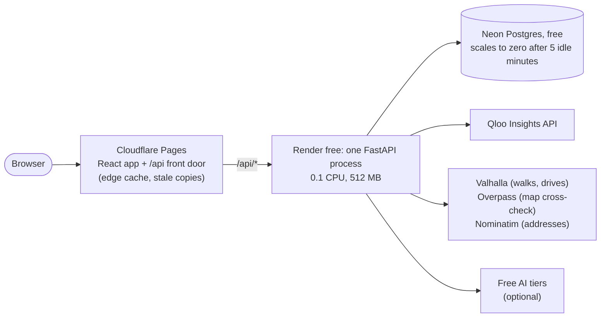
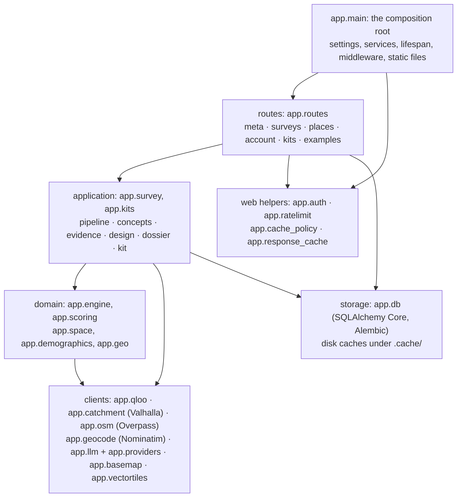
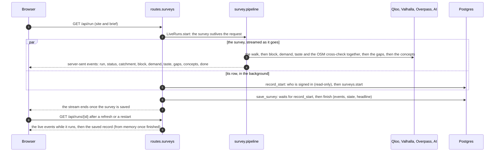
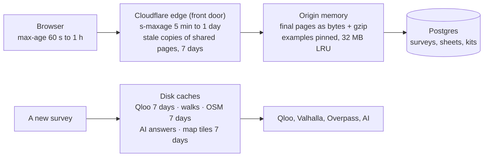
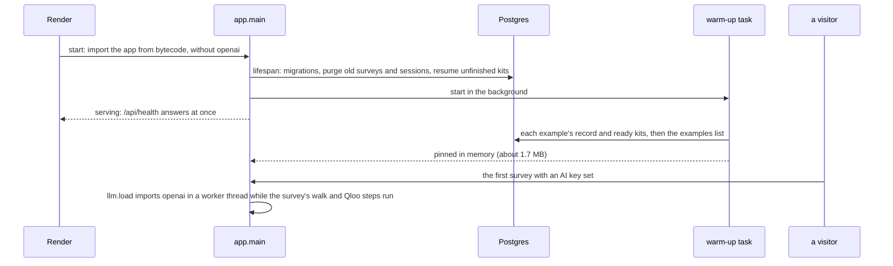
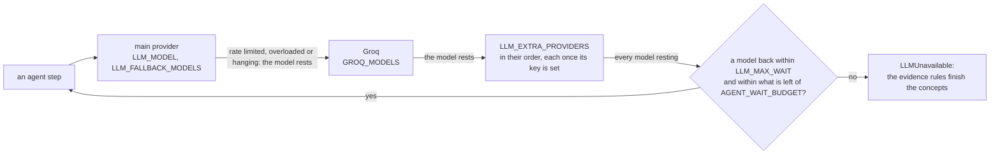

# Walk-in: backend architecture

Walk-in reads Qloo taste data for the area people can reach from a door, ranks what the block is missing and designs
the business. This page maps the backend: its layers, a survey's lifecycle, the caching layers, how cold starts are
kept off a visitor's way, the AI chain and its wait budget, and the numbers before and after the October 2026
optimisation.

## Layers

Dependencies point down: routes call the application, the application calls the domain and the clients, and only the
routes and the application touch storage.

| Layer | Modules | Job |
|---|---|---|
| Composition root | `app/main.py`, `app/services.py`, `app/config.py`, `app/providers.py` | Builds the services from the settings (`default_services`) and the app around them (`create_app`): lifespan, middleware, routers, the React build. Tests pass their own `services_factory` and database. |
| Routes | `app/routes/` | HTTP only: validate, rate-limit, call the layer below, set the cache policy. `meta` (health, presets), `surveys` (run, runs, design), `places` (catchment, heatmap, places, geocode, reverse), `account`, `kits`, `examples`. |
| Application | `app/survey/`, `app/kits.py` | A survey from a pin to designed concepts (`pipeline`); the concepts (`concepts/`: rules, agent, grounding, names, lines, offer, owner rules, wildcard, baseline); design sheets, dossiers and launch kits, built in the background. |
| Domain | `app/engine.py`, `app/scoring.py`, `app/space.py`, `app/demographics.py`, `app/geo.py` | `engine` asks Qloo one question per function (the block, demand, taste, gaps); `scoring` is pure logic over Qloo's answers, with no network. |
| Clients | `app/qloo.py`, `app/catchment.py`, `app/osm.py`, `app/geocode.py`, `app/llm.py`, `app/basemap.py`, `app/vectortiles.py` | The outside world, each with its timeouts, most with a disk cache, all with one shared TLS setup (`app/tls.py`). `app/services.py` gathers them, so tests swap in fakes. |
| Storage | `app/db/`, `.cache/` | Users, sessions, surveys (events and state), design sheets, kits; Qloo answers, walks, OpenStreetMap places, AI answers and map tiles on disk. |

Rules the code keeps: nothing below the routes imports FastAPI except the four web helpers; `app/survey` reads the
database only to restore a saved survey (`snapshot.restore`), and the routes save it. The concepts package keeps its
public names in `app/survey/concepts/__init__.py`, and its modules import only downward:
`names → lines → offer → owner_rules → wildcard → rules → grounding → agent → baseline` (tested).

## A survey's lifecycle: stream, background save, replay

- **Stream.** `GET /api/run` validates the brief, rate-limits per client and returns a `text/event-stream` at once.
  The survey runs as its own task (`LiveRuns`), so a refresh or a closed tab does not stop it. Each event is recorded
  as it is sent (`EventLog`), so a replay matches the stream; a keep-alive comment goes out after 15 quiet seconds. The
  stream is never compressed or buffered: gzip skips `text/event-stream`, and each event is one write.
- **Background save.** Neon sleeps after five idle minutes and its first query then takes 0.5-2 s, so the database
  stays off the survey's way. `record_start` runs beside the survey: it looks up who is signed in without renewing the
  session or touching cookies (`auth.session_user_id`), then inserts the row. `save_survey` waits for it, then writes
  the end. If the insert failed, the end writes the whole row; if the row was deleted meanwhile (its owner deleted the
  account), nothing is written again. A database failure never stops a survey.
- **Phases** (`pipeline.analyze_site`): the walk or drive (Valhalla, cached on disk), then the block, demand and taste
  from Qloo in parallel with the OpenStreetMap cross-check, then the gaps, then what the owner asked for: three
  concepts (the agent with live Qloo tools, or the evidence rules in a worker thread), a verdict on the business they
  want to open, or a comparison of their place with the ones people here love.
- **Replay.** `GET /api/runs/{id}` serves the live `EventLog` while the survey is in this process (`no-store`, also
  between its last event and the end of its save), then the saved record. A saved, finished record never changes, so
  it is kept in memory as the exact bytes sent and marked public for the edge. Memory keeps the state of the latest two
  surveys (`RunStore`); an older survey's state, or any after a restart, is restored from its saved snapshot when a
  design sheet or a kit needs it. The save takes the state from the survey itself, so memory letting it go cannot lose
  it. A row still "running" 15 minutes after its start is reported as failed.
- **Launch kits.** `POST /api/kits` stores a "building" kit and `KitBuilder` builds it in the background (design
  sheet, dossier, ad copy, street map from vector tiles or Overpass); a restart resumes unfinished kits. A ready kit
  without its street map gets one when it is next opened, and is not cached until it has it.

## Caching layers

A finished survey or a ready kit is answered by the first layer that holds it. Making a new survey reads the disk
caches.

| Layer | What it keeps | Key and lifetime | Kept fresh by |
|---|---|---|---|
| Browser | public API responses | URL; `max-age` | the backend's `Cache-Control` (below) |
| Edge: the front door (`frontend/functions`) | `GET` answered `200`, `public` with an `s-maxage`, without `Set-Cookie` | URL only; `s-maxage`, plus, only with `stale-if-error` (presets, config, the examples and their kits), a stale copy for up to 7 days, served only while the backend is waking, down or erroring | the same header |
| Memory: `app.response_cache` | finished run records and ready kits with their street map, as the bytes sent, and a gzipped copy made once | `run:<id>`, `kit:<token>`; the examples pinned, the rest least recently used first within `RESPONSE_CACHE_MB` (32 MB of bodies; the gzipped copies add about a quarter) | only final pages are kept, so nothing goes stale; deleting an account drops its pages, and a page read while a survey was deleted is not kept |
| Memory: `RunStore` | the latest survey states (`RUN_STORE_SIZE`, 2), for design sheets and kits; one holds 15-65 MB | survey id; the oldest leaves first | an older survey's state is restored from its saved snapshot when asked for |
| Memory: the examples list | `GET /api/examples` | the configured ids; read again in the background after 10 minutes | stale-while-revalidate; the last good list stays while the database fails |
| Postgres (Neon) | users, sessions, surveys (events, state, headline), design sheets, kits | surveys kept 60 days, the examples always | migrations in `migrations/` |
| Disk (`.cache/`) | Qloo answers as the raw bytes received, walks and drives, OpenStreetMap places, AI answers keyed by their evidence, map tiles | request hash; 7 days for Qloo, OSM and tiles | read and written in a worker thread (`asyncio.to_thread`), each file written whole (temporary file, then rename) |

The one contract with the front door is the `Cache-Control` header (`app/cache_policy.py`):

| Response | `Cache-Control` |
|---|---|
| `GET /api/presets`, `GET /api/config` | `public, max-age=300, s-maxage=3600` |
| `GET /api/examples` | `public, max-age=60, s-maxage=300` (`no-store` if read while the database failed) |
| `GET /api/runs/{id}`, finished and saved, an example | `public, max-age=3600, s-maxage=86400` |
| `GET /api/runs/{id}`, finished and saved, any other | `public, max-age=60, s-maxage=600` |
| `GET /api/kits/{token}`, ready and settled, an example's | `public, max-age=600, s-maxage=86400` |
| `GET /api/kits/{token}`, ready and settled, any other | `public, max-age=60, s-maxage=600` |
| everything else: the survey stream, surveys still in this process, building kits, `/api/me*`, `/api/auth/*`, every POST and DELETE, `/api/health`, errors | `no-store` |

A public response never depends on who asks: it carries no session, cookie or address. A guard in the security
middleware (`cache_policy.guard`) turns any `public` header into `no-store` on a non-GET, a non-200 or a response with
`Set-Cookie`. JSON leaves the backend gzipped when the client accepts it (level 6, bodies of 1 KB and more); cached
pages carry a gzipped copy made once, so serving them costs no compression.

## Cold starts

A cold path is a visitor waiting for something that has gone to sleep or has never been loaded. Each one, and what
keeps it off the visitor's way:

| Cold path | Cost when cold | What removes it |
|---|---|---|
| Render's free instance sleeps after 15 idle minutes | about 40 s for the next visitor | keep-awake through the front door: `app.keepawake` visits `KEEP_AWAKE_URL`, the front door's `/api/health`, every 5 minutes, so each visit comes in from outside like a visitor's; through the judging window a GitHub Actions cron pings the backend every 10 minutes as a backup |
| The backend is waking, deploying or down | seconds to a minute | edge stale copies: the front door answers examples, kits, presets and config from its copies (`x-walkin-cache: stale`) |
| A restart: every example read from a database that may be asleep | 1.5 s or more per page | the warm-up (`examples.warm_up`) loads each example's record and ready kits and the examples list into memory in the background; startup and `/api/health` never wait for it, and a visitor asking meanwhile shares its read |
| Neon scales to zero after 5 idle minutes | 0.5-2 s on the first query | Postgres off the critical path: a survey's row is saved beside it, the examples are served from memory, the examples list is read again in the background; `/api/health` reads no database, so the keep-awake visits never wake Neon, which still scales to zero between surveys and stays within its free compute hours |
| Importing the app at every start | 6.9 s of CPU on a laptop, about half of it the `openai` package | lazy imports and bytecode: `openai` (with its chat resources) is imported when a model is first asked, in a worker thread (`llm.load`); the image byte-compiles `app/` and `migrations/` at build time (`compileall`, checked-hash), so a start no longer compiles them from source. 3.1 s after |
| Running out of memory: a 512 MB instance is restarted, a cold start, and a survey running then is lost | a survey's state holds 15-65 MB, and 100 were kept: 462 MB after six real surveys, still climbing | memory keeps the latest two states (`RUN_STORE_SIZE`) and restores older ones from Postgres: 368 MB after the same six, level |
| Qloo's disk cache on a busy disk | a 0.3 s stall stopped every request | reads and writes in a worker thread |
| One TLS context per HTTPS client | a CA bundle parsed for each of about 7 clients | one shared context (`app.tls`), the AI providers' clients included |
| Free AI models all resting | up to 6 agent steps × `LLM_MAX_WAIT` 40 s | one `AGENT_WAIT_BUDGET` (20 s) per agent conversation |

`PYTHONDONTWRITEBYTECODE=1` stays in the image: it stops Python from writing bytecode at run time, not from reading it,
and `compileall` writes it regardless. Checked by `-v` imports with the variable set: without bytecode all 67 modules of
`app/` and `migrations/` compile from source; after `compileall` all 67 load from their `.pyc`, also after every file's
time stamp has moved; a changed source file is compiled again on its own.

## The AI chain and its wait budget

- Every call walks a chain of models across providers (`app/llm.py`). A model that fails rests, from 10 s after a
  network error to 6 hours for a model a provider no longer offers, and the next one answers. A tool-calling
  conversation stays on one model while it can.
- **Wait budget.** `AGENT_WAIT_BUDGET` (default 20 s) bounds the total time one survey's agent waits for resting
  models. A wait that would go past what is left is never started: the agent stops and the evidence rules finish, with
  the same log line and notice as when every model is resting.
- **Extra providers.** `LLM_EXTRA_PROVIDERS` adds OpenAI-compatible providers by configuration only: a JSON list of
  `{name, base_url, key_env, models[, token_limit, reasoning_effort, temperature]}`. Each is off until the variable
  `key_env` names holds a key; a malformed entry is logged and skipped, never fatal. No provider or model name is
  hard-coded beyond the defaults that were there.
- **Compact prompts.** Tool results and the evidence pack go out as compact JSON (`llm.compact_json`: no spaces, no
  null fields, whole numbers without `.0`). The system prompt and the tool schemas are unchanged, and so is the
  fingerprint saved agent answers are found by.
- **Lazy client.** The `openai` package and each provider's client are loaded when a model is first asked, in a worker
  thread, so the event loop keeps serving meanwhile. On a survey, the first ask is usually the no-data baseline, which
  starts with the survey, so the import overlaps the walk and the Qloo steps.
- No AI is required: without keys the evidence rules design the concepts. AI answers are reused while the evidence
  behind them is unchanged (`app/answers.py`).

## Performance, before and after

Measured on a development laptop, back to back against the starting code (tag `pre-optimize-2026-10-28`), in fresh
processes. The server's 0.1 CPU makes every CPU number larger; the ratios hold.

| What | Before | After |
|---|---|---|
| First survey event while Neon wakes (1.5 s simulated), anonymous | 1,560 ms | 17 ms |
| First survey event while Neon wakes, signed in | 1,568 ms | 22 ms |
| Example record (`/api/runs/{id}`), origin, after the warm-up | 9.4 ms | 2.2 ms |
| Example kit (`/api/kits/{token}`), origin, after the warm-up | 10.8 ms | 2.1 ms |
| Example record while Neon wakes (1.5 s), after the warm-up | 1,534 ms | 1.6 ms |
| Example kit while Neon wakes, after the warm-up | 1,568 ms | 1.6 ms |
| The 12 example pages on the wire | 1,668,505 B | 420,052 B (gzip) |
| Rules-mode survey from the Qloo cache, Logan Square | 2.06 s | 0.79 s |
| ... East Austin, 15-minute drive | 9.62 s | 3.54 s |
| ... Williamsburg, 10-minute walk | 5.42 s | 2.07 s |
| ... Zamalek, 10-minute walk | 4.16 s | 0.88 s |
| Qloo-bound steps, live (concurrency 6 → 12), Logan Square / Williamsburg | 17.1 / 19.0 s | 14.0 / 15.9 s |
| Agent prompt content, the agent's first three steps (fake world) | 10,406 / 14,681 / 18,194 chars | 10,118 / 14,173 / 17,458 chars |
| Worst-case agent wait for resting models | 6 steps × 40 s | 20 s |
| Parsing the 100 largest Qloo cache files (151 MB) | 4.1 s | 1.4 s |
| `import app.main`, CPU time (median of 10 runs; before: the old image, no bytecode, `openai` imported) | 6.9 s | 3.1 s |
| `import app.main`, of which user CPU, Python's own work (median of 5) | 3.2 s | 1.7 s |
| `import app.main`, wall time on this laptop (median of 10) | 13.8 s | 5.8 s |
| Modules imported by `import app.main` | 1,689 | 897 |
| Server memory after six real surveys, a walk and a drive in turn (Windows private bytes) | 462 MB, climbing | 368 MB, level |

The `openai` import (4.1 s of CPU here, with its chat resources) now happens once, in a worker thread, when the first
model is asked. Bytecode alone saves 0.6-0.9 s of CPU per start; the rest is the lazy import. The laptop's file-system
filters inflate kernel time, so user CPU is the figure closest to what a Linux server pays.

CPU hot spots removed (cProfile of rules-mode surveys from the Qloo cache):

- `scoring._matches` and `_has_word` built and ran one regex per keyword per call (634,000 per East Austin survey):
  one precompiled alternation per keyword list, and memoized checks of a genre's kind.
- `evidence.offer_items` rebuilt word sets inside a quadratic loop (600,000 generator calls): built once per item.
- `_offer_counts` scanned every tag family per tag: once per tag type.
- `catchment.simplify_ring` ran Douglas-Peucker again for each tolerance: the splits are found once.
- Qloo's cache: parsed with `orjson` (identical results; `json` is kept for what orjson would read differently), kept
  as the raw bytes Qloo sent instead of re-serialized, read and written off the event loop.
- One TLS context instead of a CA bundle parsed for each HTTPS client.
- Kit pages skip a 55 ms deep copy (`jsonable_encoder`) of a 180 KB kit.

## How it is checked

- `pytest` (server): 675 tests before, all passing after, plus tests for every change: the cache headers for each row
  of the contract, the response cache (including a page read while its survey is deleted, and a survey still saving
  its end), Postgres off the survey's critical path (a slow or failing start does not delay the first events), memory
  keeping only the latest survey states (an older one restored for its design sheet, and a survey saved whole whatever
  memory dropped), gzip and the stream flushing event by event, JSON parsing, the hot spots against the code they
  replaced, the wait budget, compact prompts, extra providers, the concepts package, and a cold start (the app imports
  without `openai`, which loads in a worker thread on first use).
- A golden check: the rules-mode output (the stream, gaps, concepts, every design sheet, the run record) of 10
  fake-world briefs and 4 real cached sites is byte-identical before and after; only the arrival order of status lines
  of steps running in parallel varies, as it always did with live Qloo.
- The routes split keeps the route table (33 routes, same order) and the OpenAPI schema identical.
- `ruff check app tests mcp_server` is clean.

## Settings added

| Variable | Default | What it does |
|---|---|---|
| `QLOO_CONCURRENCY` | 12 | Qloo requests in flight at once (6 before; 12 was fastest in live tests, 24 slower) |
| `RESPONSE_CACHE_MB` | 32 | memory for finished surveys and ready kits besides the examples |
| `RUN_STORE_SIZE` | 2 | survey states kept in memory for design sheets and kits (100 before); older ones come back from Postgres |
| `AGENT_WAIT_BUDGET` | 20 | seconds one survey's agent may wait for resting models, in all |
| `LLM_EXTRA_PROVIDERS` | empty | JSON list of extra OpenAI-compatible providers, each off until its key is set |

## Front end

The front door (`frontend/functions`, a Cloudflare Pages Function) proxies `/api` to Render and caches what the backend
marks public: a `GET` answered `200` with `public` and an `s-maxage`, without `Set-Cookie`, keyed by the URL alone, for
`s-maxage`. Only what belongs to no visitor (presets, config, the examples list, the examples' surveys and kits) carries
`stale-if-error=604800` (RFC 5861): the front door keeps a stale copy of it for a week and serves it only while the
backend is waking, down or erroring, so the examples open even then. Anyone's own survey or kit carries none, so no stale
copy of it exists and deleting an account stops its share links working within about ten minutes. Every `/api` answer
says how it was served (`x-walkin-cache: hit | miss | stale | bypass`). It never caches the survey stream.

The app itself (React and Vite, details in `frontend/README.md`):

- **Chunks.** The first screen loads 323 KB of JavaScript (673 KB before); the map with Leaflet, the survey's view,
  the design sheet, the kit and the other pages load in chunks of their own. Each lazy part holds its box while it
  loads, so nothing moves when it arrives, and sits in an error boundary, so a chunk that will not load says so in its
  place instead of taking the app down.
- **Fetching ahead.** Before its first render the app starts the code and the answer for the address it opens on;
  links start theirs when hovered, focused or touched; lists of examples fetch their surveys and kits once the browser
  is idle, never for a visitor saving data. A fetch ahead is one GET that never waits for a sleeping backend.
- **Structure.** `App.tsx` is the router: what the address shows and every move between screens. `state/screen.ts`
  names those screens, `pages/Stage.tsx` lays out the sheet beside the map, and `state/useSurveyTabs.ts` and
  `state/useBriefForm.ts` hold the survey's tabs and the brief being filled in.
- **Pictures.** Qloo's small thumbnails load its 200-px variant (a third of the bytes), then the original, then
  initials.
- **Measured.** First paint comes 32-44% sooner on a throttled phone on every page and the survey's map 2.6 s sooner;
  the table is in `frontend/README.md`.
